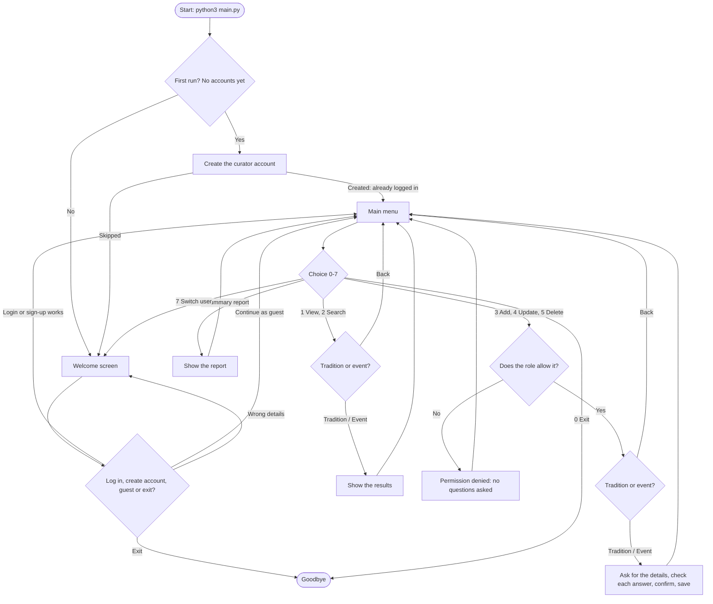

# Heritage: Traditions and Events

A command-line application for recording and exploring cultural traditions and
the events that celebrate them. It is a menu-driven Python application that
stores its data in a SQLite database.

**Peer Learning Project 2, Group 3 (African Leadership University, BSE Year 1, Trimester 2)**

## What it does

- Record **traditions** (name, region, category, description) and **events**
  (name, date, location, an optional related tradition, description).
- **View**, **search** (by any text, any case), **add**, **update** and
  **delete** records.
- A **summary report**: totals, upcoming events, and traditions by category
  and by region.
- **Accounts and roles**, so only the right people can change or remove records.

## Quick start

Requires Python 3.8 or newer. There is nothing to install: only the standard
library is used.

```bash
python3 main.py --demo      # start with a few sample records
python3 main.py             # start with an empty database
python3 main.py --db my.db  # use a different database file
```

On the very first run the app asks you to create the **curator** account (the
administrator). After that you can log in, create a contributor account, or
continue as a read-only guest. The data is saved in `heritage.db`.

## Roles and permissions

| Action | Guest (not logged in) | Contributor | Curator |
|--------|:---------------------:|:-----------:|:-------:|
| View, search, summary report | yes | yes | yes |
| Add a record | no | yes | yes |
| Update a record | no | yes | yes |
| Delete a record | no | no | yes |

Anyone can create a **contributor** account from the welcome screen. The
**curator** account is created once, on the first run. If your role does not
allow an action, the app says so straight away and returns to the menu,
**before asking any questions**.

## Architecture

The code is split into three layers. Each layer only talks to the one below it.

```
  main.py              starts the app
     |
     v
  heritage/menu.py       MENU layer      what the user sees and types
     |                   (HeritageCLI: menus, prompts, tables, permission checks)
     v
  heritage/service.py    SERVICE layer   the rules of the app
     |                   (validation, roles and permissions, accounts, reports)
     v
  heritage/database.py   DATABASE layer  the only code that touches SQLite
                         (parameterised SQL: create, read, update, delete)
```

| Layer | File | Responsibility |
|-------|------|----------------|
| Menu | `heritage/menu.py` | The user journey: the menu loop, the choices, reading input, showing results. No SQL and no business rules. |
| Service | `heritage/service.py` | Every rule lives here once: field validation, who may do what, password handling, report numbers. |
| Database | `heritage/database.py` | The SQLite schema and all queries. It makes no decisions. |

Why three layers? A change stays in one place (a new rule is added in the
service, a new screen in the menu), and each layer can be tested on its own.
The service also checks permissions itself, so the rules hold even if a menu
check were ever missed.

### The user journey

`HeritageCLI.run()` in `heritage/menu.py` is the central decision point: it
shows the main menu, reads a choice, runs the matching action, and returns to
the menu until the user chooses to exit.

- `run()` is the menu loop. Each choice leads to exactly one action.
- `_pick_record_type()` is the branch where the user chooses a **tradition** or
  an **event** (or goes back).
- `_add_record()`, `_update_record()` and `_delete_record()` each start with a
  **permission check** (`_allowed()`), which sends the user away before any
  question is asked if their role does not allow the action.



> The flowchart above is a text diagram that GitHub draws automatically. If you
> have a designed flowchart image, add it to a `docs/` folder and link it here.

## Project structure

```
main.py                  entry point (--db, --demo)
heritage/
    menu.py              menu layer (HeritageCLI)
    service.py           service layer (rules, roles, accounts)
    database.py          database layer (SQLite)
    sample_data.py       sample records for --demo
tests/
    test_service.py      rules, permissions, accounts, search, reports
    test_menu.py         the whole user journey with scripted keyboard input
```

## Running the tests

```bash
python3 -m unittest discover -s tests -t .
```

The tests use an in-memory database, so they never touch `heritage.db`. The menu
tests feed scripted keystrokes to the real menu loop and check what the user
would see, including that a denied user is never asked any question.

## Design and safety notes

- **SQL injection:** every query uses placeholders. The few column names that
  appear in SQL text come from fixed whitelists in `database.py`. Search
  wildcards (`%` and `_`) typed by the user are treated as plain characters.
- **Passwords:** never stored as typed. Each is salted and hashed with
  PBKDF2-SHA256 (200,000 rounds), and compared in constant time. A wrong user
  name and a wrong password give the same message.
- **No built-in passwords:** the curator account is created by whoever runs the
  app first, so no default login is shipped in the code.
- **Input checks:** required fields, maximum lengths, a fixed category list,
  real calendar dates (`YYYY-MM-DD`), and a related tradition that must exist.
  Bad answers are explained and asked again.
- **Deleting a tradition** keeps its events; they simply lose the link.
- **Ctrl+C or Ctrl+D** leaves the app politely, with no error text.
- The sample records (`--demo`) are illustrative only.
